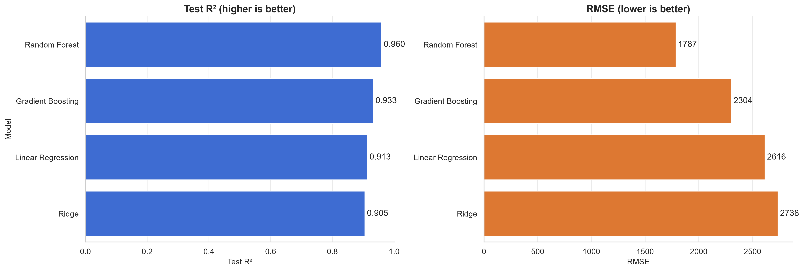

# Car Price Prediction

A machine learning project that predicts car prices from their specifications.

## Overview
- Data cleaning and preprocessing
- Exploratory data analysis with visualizations
- Feature engineering (power-to-weight ratio, average MPG, brand extraction)
- Models compared: Linear Regression, Ridge, Random Forest, Gradient Boosting

## Results
Best model: **Random Forest** with **R² = 0.960** and **RMSE ≈ $1,787** on the test set.

| Model | Test R² | RMSE |
|---|---|---|
| Random Forest | 0.960 | 1,787 |
| Gradient Boosting | 0.933 | 2,304 |
| Linear Regression | 0.913 | 2,616 |
| Ridge | 0.905 | 2,738 |

## Tech Stack
Python, pandas, NumPy, scikit-learn, seaborn, matplotlib

## Files
- `CarPrice.ipynb`: full analysis and modeling
- `CarPrice_Assignment.csv`: dataset
- `images/`: generated charts
